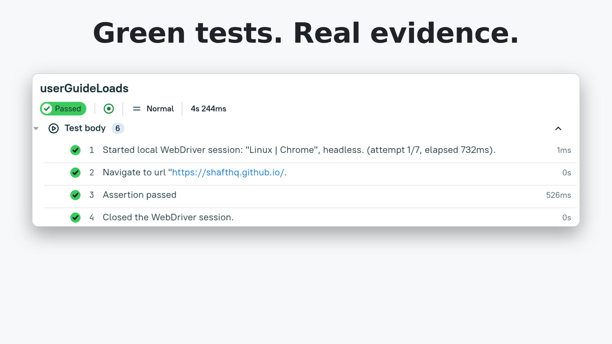
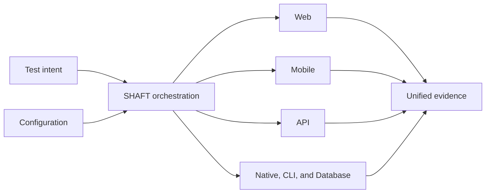

<div align="center">

<picture>
  <source media="(prefers-color-scheme: dark)" srcset="shaft-engine/src/main/resources/images/shaft_white.png">
  
</picture>

# SHAFT

**Write the test. SHAFT handles drivers, waits, evidence, and the report.**

One Java engine for web, mobile, API, CLI, database, and desktop, with an Allure report on every run.

[](https://central.sonatype.com/artifact/io.github.shafthq/shaft-engine)
[](https://github.com/ShaftHQ/SHAFT_ENGINE/actions/workflows/pr-gate.yml)
[](https://scorecard.dev/viewer/?uri=github.com/ShaftHQ/SHAFT_ENGINE)
[](https://app.codecov.io/gh/ShaftHQ/SHAFT_ENGINE)
[](LICENSE)
[](https://github.com/ShaftHQ/SHAFT_ENGINE/stargazers)


<a href="https://github.com/ShaftHQ/SHAFT_ENGINE/releases/download/shaft-hero-video-20261017/shaft-hero-16x9.mp4">
  <picture>
    <source media="(prefers-color-scheme: dark)" srcset=".github/assets/readme/shaft-hero-thumb-dark-1280x720.jpg">
    
  </picture>
</a>

<sub>▶ Watch the 26-second clip with captions · [100-second overview](https://github.com/ShaftHQ/SHAFT_ENGINE/releases/download/shaft-feature-video-v2-20261009/SHAFT-business-16x9-v2-1080p.mp4)</sub>

**[⭐ Star SHAFT](https://github.com/ShaftHQ/SHAFT_ENGINE)** · **[Generate your first project](https://shafthq.github.io/)** · **[Read the User Guide](https://shafthq.github.io/)**

</div>

## Why SHAFT

- **Stop rebuilding plumbing.** Managed Selenium and Appium drivers, synchronized actions, and smart waits work out of the box.
- **One fluent API, every surface.** Web, mobile, REST/GraphQL, database, CLI, and desktop live in the same test.
- **Evidence by default.** Logs, screenshots, and attachments flow into an Allure report on every run.
- **Scale by configuration.** Run the same test locally, on Grid, BrowserStack, or LambdaTest, with TestNG, JUnit, or Cucumber.
- **Open and trusted.** MIT licensed, published to Maven Central, with an OpenSSF Scorecard and a public coverage report.

## How it works

Test intent and configuration enter SHAFT's orchestration layer, fan out across the execution surfaces you need, and come back as unified evidence.



## 30-second quickstart

The fastest route is to **[generate your first project](https://shafthq.github.io/)** and run `mvn test`. To add SHAFT to an existing project, use `io.github.shafthq:shaft-engine` (take the version from the Maven Central badge):

```xml
<dependency>
    <groupId>io.github.shafthq</groupId>
    <artifactId>shaft-engine</artifactId>
    <version>${shaft.version}</version>
</dependency>
```

```java
SHAFT.GUI.WebDriver driver = new SHAFT.GUI.WebDriver();
driver.browser().navigateToURL("https://shafthq.github.io/")
      .and().element().assertThat(By.cssSelector("h1")).isVisible();
driver.quit();
```

Run `mvn test` and the Allure report opens with every step, screenshot, and log.

## Next steps

| You are | Go to |
|---|---|
| Writing tests | **[User Guide](https://shafthq.github.io/)**: setup, the full API, and examples |
| Using IntelliJ | [shaft-intellij](shaft-intellij/README.md) |
| Contributing or maintaining | [CONTRIBUTING.md](CONTRIBUTING.md), the maintainers guide entry point |
| An AI agent | [AGENTS.md](AGENTS.md); start with `$shaft-developer`, then the [MCP tools](shaft-skills/references/shaft-mcp-tools.md) or [CLI commands](shaft-skills/references/shaft-cli-commands.md) |

<div align="center">

**If SHAFT saves your team time, [⭐ star the repo](https://github.com/ShaftHQ/SHAFT_ENGINE). It helps other testers find it.**

</div>

---

[Open an issue](https://github.com/ShaftHQ/SHAFT_ENGINE/issues) · [Code of Conduct](CODE_OF_CONDUCT.md) · [Security](SECURITY.md) · [Sponsor](https://github.com/sponsors/MohabMohie)

BrowserStack, LambdaTest, Applitools, and JetBrains have provided tooling or open-source program support. This is support for the project, not a claim of financial sponsorship, customer status, or endorsement.
