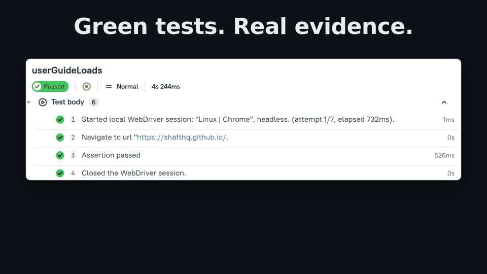
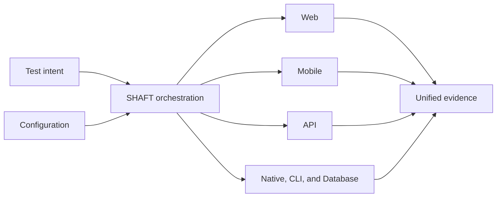

<div align="center">

<picture>
  <source media="(prefers-color-scheme: dark)" srcset="shaft-engine/src/main/resources/images/shaft_white.png">
  
</picture>

# Write the test. SHAFT does the rest.

One Java engine for web, mobile, API, CLI, database, and desktop.<br>
Drivers, waits, and evidence are handled. Every run ends in an Allure report.

[](https://shafthq.github.io/)
&nbsp;
[](https://github.com/ShaftHQ/SHAFT_ENGINE)

[](https://central.sonatype.com/artifact/io.github.shafthq/shaft-engine)
[](https://github.com/ShaftHQ/SHAFT_ENGINE/actions/workflows/pr-gate.yml)
[](https://app.codecov.io/gh/ShaftHQ/SHAFT_ENGINE)

<a href="https://github.com/ShaftHQ/SHAFT_ENGINE/releases/download/shaft-hero-video-20261017/shaft-hero-16x9.mp4">
  <picture>
    <source media="(prefers-reduced-motion: reduce) and (prefers-color-scheme: dark)" srcset=".github/assets/readme/shaft-hero-thumb-dark-1280x720.jpg">
    <source media="(prefers-reduced-motion: reduce)" srcset=".github/assets/readme/shaft-hero-thumb-light-1280x720.jpg">
    
  </picture>
</a>

<sub>**Upgrade to SHAFT_ENGINE** · ▶ [Watch the 26-second clip with sound and captions](https://github.com/ShaftHQ/SHAFT_ENGINE/releases/download/shaft-hero-video-20261017/shaft-hero-16x9.mp4) · [100-second overview](https://github.com/ShaftHQ/SHAFT_ENGINE/releases/download/shaft-feature-video-v2-20261009/SHAFT-business-16x9-v2-1080p.mp4)</sub>

</div>

## Why SHAFT

- **No plumbing.** Managed Selenium and Appium drivers, synchronized actions, and smart waits.
- **One fluent API.** Web, mobile, REST/GraphQL, database, CLI, and desktop in the same test.
- **Evidence by default.** Steps, screenshots, and logs land in an Allure report on every run.
- **Scale by configuration.** Local, Grid, BrowserStack, or LambdaTest; TestNG, JUnit, or Cucumber.
- **Open and trusted.** MIT licensed, on Maven Central, with public coverage.

## How it works

Test intent and configuration enter SHAFT's orchestration layer, fan out across the execution surfaces you need, and come back as unified evidence.



## Quickstart

**[Generate your first project](https://shafthq.github.io/)** and run `mvn test`. Already on Maven? Add `io.github.shafthq:shaft-engine` (version from the Maven Central badge):

```xml
<dependency>
    <groupId>io.github.shafthq</groupId>
    <artifactId>shaft-engine</artifactId>
    <version>${shaft.version}</version>
</dependency>
```

Then write the test:

```java
SHAFT.GUI.WebDriver driver = new SHAFT.GUI.WebDriver();
driver.browser().navigateToURL("https://shafthq.github.io/")
      .and().element().assertThat(By.cssSelector("h1")).isVisible();
driver.quit();
```

Run `mvn test`. The Allure report opens with every step, screenshot, and log.

## Where to next

- **Writing tests:** the **[User Guide](https://shafthq.github.io/)** has setup, the full API, and examples.
- **Using IntelliJ:** [shaft-intellij](shaft-intellij/README.md).
- **Contributing or maintaining:** [CONTRIBUTING.md](CONTRIBUTING.md) is the entry point to the maintainers guide.
- **AI agents:** [AGENTS.md](AGENTS.md). Start with `$shaft-developer`, then the [MCP tools](shaft-skills/references/shaft-mcp-tools.md) or [CLI commands](shaft-skills/references/shaft-cli-commands.md).
- **Training:** hands-on courses at [automatest.org](https://www.automatest.org).

<div align="center">

**If SHAFT saves your team time, star the repo.** It helps other testers find it.

[](https://github.com/ShaftHQ/SHAFT_ENGINE)

</div>

---

[Open an issue](https://github.com/ShaftHQ/SHAFT_ENGINE/issues) · [Code of Conduct](CODE_OF_CONDUCT.md) · [Security](SECURITY.md) · [Sponsor](https://github.com/sponsors/MohabMohie)

<sub>BrowserStack, LambdaTest, Applitools, and JetBrains have provided tooling or open-source program support. This is support for the project, not a claim of financial sponsorship, customer status, or endorsement.</sub>
